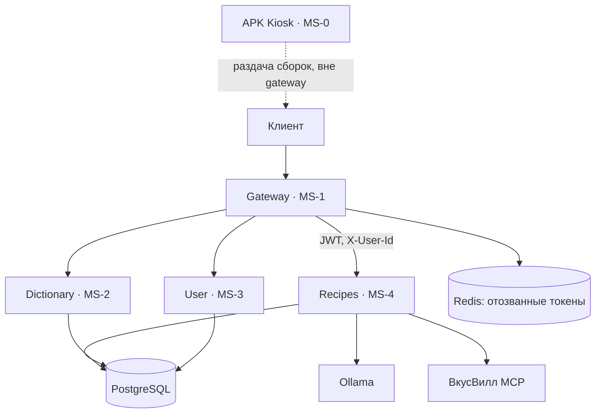

# Smart Meal AI

**Smart Meal AI** — сервис генерации меню и рецептов на неделю с учётом количества
едоков, бюджета, привычек питания, диеты, аллергий и доступной кухонной техники.
Меню собирает локальная нейросеть (Ollama), а ингредиенты можно сразу превратить в
ссылку на корзину ВкусВилла.

Репозиторий узловой: здесь публичное описание продукта, архитектуры и состава
сервисов. Исходный код лежит в отдельных репозиториях `smai-*`.

## Пользовательский сценарий

1. Клиент получает справочники привычек, диет, аллергенов и техники.
2. Отправляет параметры: число едоков, недельный бюджет и выбранные ID.
3. Получает идентификатор задачи генерации.
4. Опрашивает статус и забирает готовое меню с рецептами, ингредиентами и
   инструкциями.
5. Меняет отдельные блюда, ставит лайки, смотрит историю меню.
6. Подбирает товары для рецепта и получает ссылку на корзину магазина.

## Архитектура



- Наружу опубликован только gateway с белым списком маршрутов.
- Gateway проверяет JWT, срезает клиентский `X-User-Id` и передаёт сервисам
  доверенный идентификатор пользователя.
- Сервисы не доверяют друг другу по токену: их защищает сетевая изоляция.
- Kiosk (MS-0) стоит отдельно: это внутренний сервис раздачи Android-сборок, а не
  клиентское приложение.

## Сервисы

| ID | Репозиторий | Ответственность | Стек |
|---|---|---|---|
| MS-1 | [smai-api-gateway](https://github.com/Sun1tAr/smai-api-gateway) | Единая точка входа, маршрутизация, JWT, лимиты запросов, отзыв токенов | FastAPI, httpx, PyJWT ES256, Redis |
| MS-2 | [smai-api-dictionary](https://github.com/Sun1tAr/smai-api-dictionary) | Четыре справочника: привычки, диеты, аллергены, техника | FastAPI, SQLAlchemy, Alembic |
| MS-3 | [smai-api-user](https://github.com/Sun1tAr/smai-api-user) | Регистрация, проверка пароля, профиль | FastAPI, argon2id, SQLAlchemy |
| MS-4 | [smai-api-receipes](https://github.com/Sun1tAr/smai-api-receipes) | Генерация меню, рецепты, замена блюд, лайки, история, корзина | FastAPI, Ollama, MCP, SQLAlchemy |
| MS-0 | [smai-sys-apk-kiosk](https://github.com/Sun1tAr/smai-sys-apk-kiosk) | Хранение и выдача APK, страница версий | FastAPI, PostgreSQL, файловое хранилище |
| — | [smai-infra](https://github.com/Sun1tAr/smai-infra) | Compose-стеки, сети, деплой, наблюдаемость | Docker Compose, GitHub Actions |

Порты: в локальном Compose gateway публикуется на `8080`, recipes — `8001`,
dictionary — `8002`, user — `8003`, kiosk — `8000`. Внутри сети все сервисы
слушают `8000`. На сервере gateway опубликован на `8000`, kiosk — на `8888`.

## API

Всё, что доступно клиенту, проходит через gateway. Неизвестный путь даёт 404,
неверный метод — 405; служебные `/health`, `/metrics`, `/docs` сервисов через
gateway недоступны.

| Метод | Публичный путь | Сервис | Auth |
|---|---|---|---|
| `POST` | `/auth/register` | MS-3 + JWT | нет |
| `POST` | `/auth/login` | MS-3 + JWT | нет |
| `POST` | `/auth/logout` | gateway + Redis | JWT |
| `GET` | `/user/profile` | MS-3 | JWT |
| `GET` | `/dictionaries` | MS-2 | нет |
| `POST` | `/recipes/generate-menu` | MS-4 | необязательна |
| `GET` | `/recipes/generate-menu/{task_id}` | MS-4 | нет |
| `POST` | `/recipes/generate-menu/{task_id}/replace-recipe` | MS-4 | нет |
| `GET` | `/recipes/profile/parameters` | MS-4 | JWT |
| `GET` | `/recipes/profile/menus` | MS-4 | JWT |
| `POST` | `/recipes/cart` | MS-4 | необязательна |
| `POST` | `/recipes/cart/link` | MS-4 | нет |
| `POST` | `/recipes/{recipe_id}/like` | MS-4 | JWT |
| `DELETE` | `/recipes/{recipe_id}/like` | MS-4 | JWT |
| `GET` | `/recipes/liked` | MS-4 | JWT |
| `GET` | `/health`, `/metrics`, `/docs`, `/openapi.json` | gateway | нет |

Гостевые сценарии (генерация, статус, замена, корзина, справочники) работают без
токена; профильные данные и лайки требуют JWT.

## Аутентификация

- Gateway подписывает JWT алгоритмом `ES256` ключом EC P-256 и сам его проверяет.
  Claims: `iss=smai-gateway`, `sub=userId`, `jti`, `iat`, `nbf`, `exp`.
- Срок жизни — `JWT_TTL_SECONDS` (по умолчанию 24 часа).
- `POST /auth/logout` пишет в Redis `revoked:{jti}` до истечения токена; повторный
  logout и защищённые запросы с этим токеном получают 401.
- Пароли хранит MS-3: `argon2id`, `time_cost=3`, `memory_cost=65536` КиБ. Логин
  нормализуется (email, нижний регистр), пароль — нет.
- При недоступном Redis защищённые маршруты отвечают 503, а не 401.

## Генерация меню

1. `POST /recipes/generate-menu` проверяет параметры и ID справочников через MS-2.
2. Задача сохраняется со снимком промпта: смена шаблона не влияет на очередь.
3. Фоновый воркер MS-4 берёт самую старую задачу (`FOR UPDATE SKIP LOCKED`),
   собирает промпт из шаблона, ограничений пользователя и последних лайков.
4. Один запрос к Ollama (`qwen2.5:7b` по умолчанию), валидация ответа: не меньше
   трёх блюд, без дублей и пустых строк.
5. В одной транзакции сохраняются меню, рецепты, ингредиенты и инструкции, задача
   переходит в `done`.
6. `GET /recipes/generate-menu/{task_id}` возвращает `status`, `menu` и `error`.

Замена блюда идёт через ту же очередь отдельным шаблоном `replace` и ждёт
результат ограниченное время. Невалидный ответ модели повторяется, таймаут и
недоступность Ollama — нет. При сбоях Ollama воркер уходит в паузу 5 → 10 → 20 →
40 → 60 секунд.

Корзина: `POST /recipes/cart` подбирает товары по каталогу ВкусВилла через MCP,
`POST /recipes/cart/link` собирает ссылку на корзину. Без настроенного
`VKUSVILL_MCP_URL` корзина отвечает 503, остальной продукт работает.

## Данные

- Один экземпляр PostgreSQL, у каждого сервиса свои таблицы и своя таблица версий
  Alembic (`alembic_version_user`, `alembic_version_dictionary`,
  `alembic_version_receipes`; киоск использует таблицу по умолчанию
  `alembic_version`).
- Redis хранит только отозванные JWT; данные приложения в нём не живут.
- APK хранится в томе `smai-kiosk-apk-data`; в БД только метаданные версии.

## Инфраструктура

[smai-infra](https://github.com/Sun1tAr/smai-infra) описывает пять стеков:
`services`, `postgres`, `redis`, `ai`, `observability`. Сервисные репозитории
собирают образ в GHCR и при push в `develop`/`main` вызывают деплой через
`repository-dispatch`; сам деплой идёт по SSH через туннель NetBird.

Наблюдаемость: Prometheus, Grafana, Loki + Promtail, Tempo, OTel Collector и
Alertmanager с уведомлениями в Telegram. Все сервисы отдают JSON-логи с
`trace_id` и `request_id`, метрики на `/metrics` и трейсы по OTLP.

## Состояние репозиториев

| Репозиторий | Ветка с кодом | Что в `main` |
|---|---|---|
| `smai-api-gateway` | `develop` | README |
| `smai-api-user` | `develop` | README |
| `smai-api-receipes` | `develop` | README |
| `smai-api-dictionary` | `develop` | README |
| `smai-sys-apk-kiosk` | `develop` | README |
| `smai-infra` | `main` | Конфигурация и workflow |

README сервисов описывают состояние `develop`. Ветки `develop` в рамках подготовки
портфолио не изменяются.

## Локальный запуск

Каждый сервис запускается своим `docker compose` в собственной сети `smai`
(создаётся один раз):

```sh
docker network create smai
```

Порядок для полного контура:

1. `smai-infra/postgres` — PostgreSQL.
2. `smai-infra/redis` — Redis для отзыва токенов.
3. `smai-infra/ai` или локальная Ollama с загруженной моделью.
4. `smai-api-dictionary`, `smai-api-user`, `smai-api-receipes` — по своим
   `.env.example`.
5. `smai-api-gateway` — с адресами `http://dictionary:8000`,
   `http://user:8000`, `http://recipes:8000` и путём к JWT-ключу.

Проверка:

```sh
curl --fail http://127.0.0.1:8080/health
curl --fail http://127.0.0.1:8080/dictionaries
```

Подробности по переменным, тестам и миграциям — в README соответствующего
репозитория.

## Документация

| Документ | Содержание |
|---|---|
| [docs/architecture.md](docs/architecture.md) | Компоненты и связи |
| [docs/services.md](docs/services.md) | Карта сервисов |
| [docs/decisions.md](docs/decisions.md) | Принятые инженерные решения |

Аналитические материалы проекта (требования, сценарии, схемы, решения по
сервисам) ведутся отдельным архивом проектной документации и в этот репозиторий не
входят.

## Моя роль

Team lead, tech lead и архитектор: технический вектор, декомпозиция работы,
согласование контрактов между сервисами, ревью, DevOps-процессы и единое
архитектурное видение продукта.

## Известные ограничения

- Все сервисы работают в одной реплике. Лимиты запросов gateway и лимит
  хэширования MS-3 хранятся в памяти процесса и не синхронизируются между
  репликами.
- Воркер генерации — один asyncio-таск в процессе MS-4; горизонтально он не
  масштабируется. Дополнительно он держит `pg_try_advisory_lock`.
- Миграции в entrypoint сервисов выполняются без advisory lock: параллельный
  старт нескольких реплик не сериализуется.
- Продукт зависит от Ollama и Redis. Без Ollama не работает генерация, без Redis
  защищённые маршруты отвечают 503.
- Корзина требует внешний MCP ВкусВилла; без него доступен остальной функционал.
- Между сервисами нет mTLS: защита строится на сетевой изоляции и срезании
  клиентских заголовков.
- Клиентского приложения (Android) в публичном портфолио нет — MS-0 только
  раздаёт сборки.
- Базовые образы закреплены тегами, а не digest.

## Репозитории

- [smai-api-gateway](https://github.com/Sun1tAr/smai-api-gateway)
- [smai-api-user](https://github.com/Sun1tAr/smai-api-user)
- [smai-api-receipes](https://github.com/Sun1tAr/smai-api-receipes)
- [smai-api-dictionary](https://github.com/Sun1tAr/smai-api-dictionary)
- [smai-sys-apk-kiosk](https://github.com/Sun1tAr/smai-sys-apk-kiosk)
- [smai-infra](https://github.com/Sun1tAr/smai-infra)
