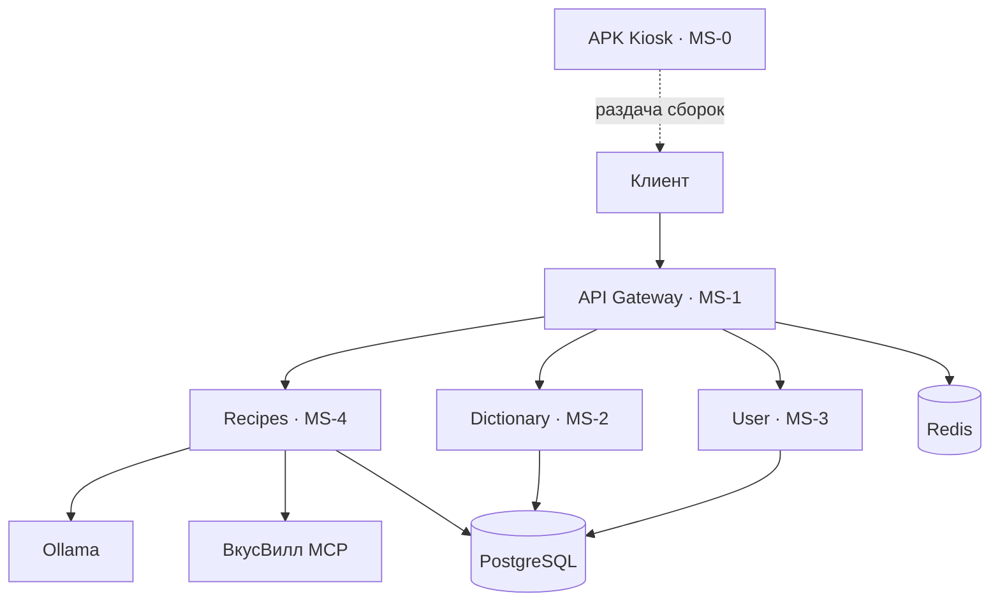

# Архитектура Smart Meal AI

## Общая схема

Киоск версий APK стоит вне gateway: это внутренний сервис раздачи Android-сборок,
а не клиентское приложение. Ссылки на скачивание выдаются напрямую.

## Основные архитектурные решения

- сервисы разделены по предметным областям: пользователи, справочники, рецепты и
  генерация;
- наружу опубликован только gateway с белым списком маршрутов; он проверяет JWT и
  передаёт сервисам доверенный `X-User-Id`;
- длительная генерация меню оформляется как задача: клиент получает `task_id` и
  отдельно опрашивает состояние и результат;
- генерация выполняется локальной моделью в Ollama, поэтому таймаут и деградация
  модели — штатные состояния, а не авария;
- конфигурация передаётся через окружение и шаблоны, а не через секреты в коде;
- инфраструктура и наблюдаемость вынесены в отдельный репозиторий `smai-infra`.

## Ветки

Актуальный код сервисов — в ветке `develop`; в `main` лежат README. Ветки
`develop` в рамках подготовки портфолио не изменяются. Инфраструктурный
репозиторий использует `main` как рабочую ветку.
